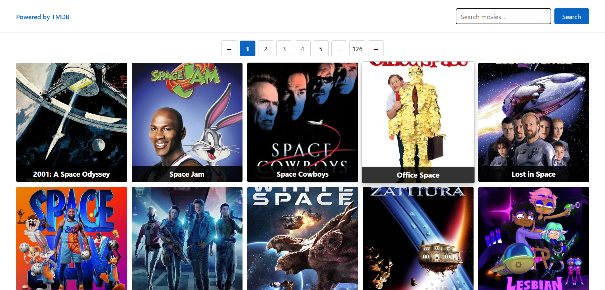
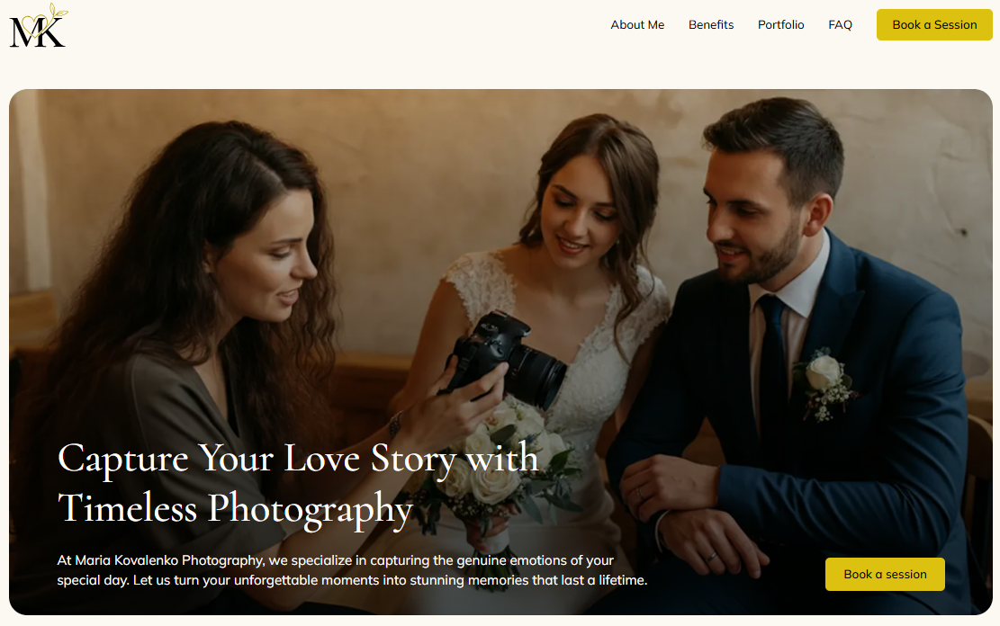
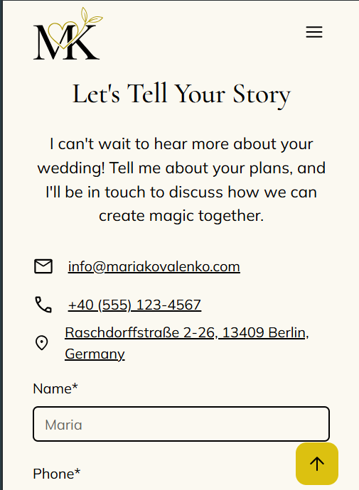

# Hi, I'm Hryhorii Shalashnyi 👋

### Fullstack Developer

**React · TypeScript · JavaScript · HTML · CSS**

I build responsive web interfaces and interactive applications, with a focus on clean code,
reusable components, and a smooth user experience.

[LinkedIn](https://www.linkedin.com/in/hryhorii-shalashnyi) ·
[Telegram](https://t.me/rock_n_roll_v_ushah) ·
[Email](mailto:shalashnyihryhorii@gmail.com) ·
[Resume](https://drive.google.com/file/d/1AtA0mC9izfAdFP4AXeTQLCh9iOgQ14Pt/view?usp=drivesdk)

---

## 👨‍💻 About Me

I'm a fullstack developer focused on building modern, responsive web applications with
**React, TypeScript, and JavaScript**.

I enjoy transforming ideas and designs into functional interfaces, integrating REST APIs,
managing server state, and solving practical development problems. I'm continuously
improving my skills and currently expanding my knowledge of **Next.js**.

My goal is to grow as a developer by building useful products, learning from real-world
challenges, and writing maintainable code.

## 🛠️ Tech Stack

**Languages & Markup**

**Frameworks, Libraries & Tools**

**Currently Learning**

## 🚀 Featured Projects

### 🎬 Movie Search App

A movie discovery application built with React and TypeScript. It uses the TMDB API to
search for movies and display paginated results.

**What I implemented**
- Movie search with input validation.
- API requests with Axios.
- Server-state management and caching with TanStack Query.
- Pagination and loading, error, and empty states.
- Movie details modal.
- React Query Devtools integration.

**Built with:** React · TypeScript · TanStack Query · Axios · Vite

<strong>📸 View project screenshot</strong>

 

---

### 📸 Wedding Photographer Landing Page

A responsive landing page for a wedding photographer, created as part of a team project.
The website presents the photographer's services, portfolio, and contact information,
with a layout adapted for desktop and mobile screens.

**What I worked with**
- Responsive layout and Mobile First principles.
- Semantic HTML and structured page sections.
- Styling with Sass and CSS.
- JavaScript for interactive interface elements.
- Team-based development workflow.

**Built with:** HTML5 · CSS3 · Sass · JavaScript

<strong>📸 View project screenshots</strong>

 

**Desktop**

**Mobile**

## 📊 GitHub Overview

## 🗣️ Languages

-  **English:** B2
-  **German:** A2
-  **Ukrainian:** Native

## 📫 Contact

- **LinkedIn:** [hryhorii-shalashnyi](https://www.linkedin.com/in/hryhorii-shalashnyi)
- **Telegram:** [@rock_n_roll_v_ushah](https://t.me/rock_n_roll_v_ushah)
- **Email:** [shalashnyihryhorii@gmail.com](mailto:shalashnyihryhorii@gmail.com)
- **Resume:** [View my resume](https://drive.google.com/file/d/1AtA0mC9izfAdFP4AXeTQLCh9iOgQ14Pt/view?usp=drivesdk)

---

*Always learning. Always building. Always improving.* 🚀

